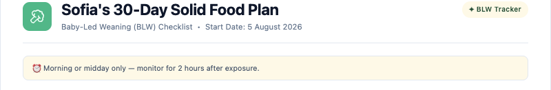
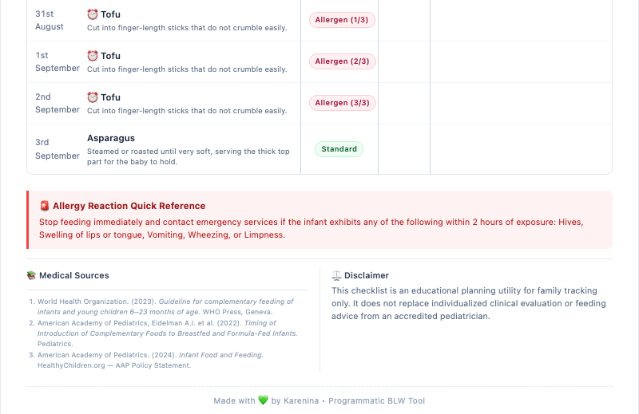

# 🥑 BLW Solids Tracker

A free tool for parents who start baby-led weaning (BLW). It helps you introduce solid foods in a safe order, with extra care for **foods that can cause allergies**.

👉 **[Try it live](https://blw.kareninatech.com/)**

<details>
  <summary>📸 See the printable checklist</summary>
  <br>
  
  <br><br>
  
</details>

---

## What it does

- **Readiness check**: checks your baby's age and skills against WHO and AAP advice
- **Food list**: matches your baby's age, diet and allergies
- **30-day plan**: a safe schedule from the day you choose
- **Printable checklist**: an A4 page with foods, how to prepare them, and an allergy guide
- **Browse foods**: search and filter every food in the list
- **Contribute a food**: suggest a missing food, and it is reviewed before it goes live
- **Blog**: guides and personal stories
- **English and Spanish**
- **Private**: your baby's name and answers stay in your browser

---

## Run it locally

```bash
npm install
npm run dev
```

Open [http://localhost:3000](http://localhost:3000).

### Environment variables

Put these in a local `.env` file (never commit it).

| Variable | Used for |
|---|---|
| `GITHUB_TOKEN`, `GITHUB_OWNER`, `GITHUB_REPO` | The "Contribute a food" form (it opens a GitHub issue) |
| `STAGING_PASSWORD` | Password for preview deployments |

### Scripts

| Script | What it does |
|---|---|
| `npm run dev` | Start the dev server |
| `npm run build` | Production build |
| `npm run lint` | Check the code style |
| `npm run test` | Run tests |
| `npm run verify` | Run all checks (also runs before every commit) |

---

## Tech stack

Next.js 16, React 19, TypeScript, Tailwind CSS 4, Zod, react-i18next, lucide-react, Jest. Hosted on Vercel, with Cloudflare for DNS.

---

## Blog

Articles are Markdown files in [`content/blog/`](content/blog). The file name is the web address.

- `type: guide` needs at least one source.
- `type: story` is a personal post and needs no source.
- `draft: true` hides an article.
- With no articles, the blog shows a friendly "getting ready" message.

Full steps are in [`content/blog/README.md`](content/blog/README.md).

---

## Contributing

Use the **Contribute** tab in the app to suggest a food. You can also open a pull request that changes [`src/data/foodDataset.ts`](src/data/foodDataset.ts).

---

## Deployment

Vercel deploys `main` to production. Other branches get a preview, protected by a password. GitHub Actions runs `npm run verify` on every pull request. Dependabot opens weekly update pull requests.

---

## ⚠️ Safety

- This tool does **not** replace medical advice.
- Ask your pediatrician before you start solids.
- Never leave your baby alone while eating.
- Cut and prepare food in a safe size and texture to prevent choking.
